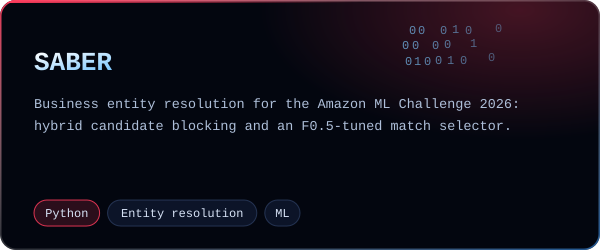
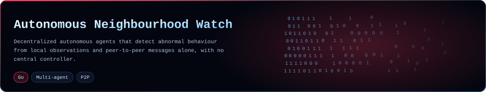

  

  

  

  

  
  

  
  

  

  

  

Metrics as a table

| Week starting | Contributions |
|---|---:|
| 14 Jun 2026 | 0 |
| 21 Jun 2026 | 6 |
| 28 Jun 2026 | 13 |
| 5 Jul 2026 | 9 |
| 12 Jul 2026 | 5 |
| 19 Jul 2026 | 5 |
| 26 Jul 2026 | 8 |
| 2 Aug 2026 | 15 |
| 9 Aug 2026 | 12 |
| 16 Aug 2026 | 7 |
| 23 Aug 2026 | 6 |
| 30 Aug 2026 | 1 |
| 6 Sep 2026 | 1 |
| 13 Sep 2026 | 6 |
| 20 Sep 2026 | 5 |
| 27 Sep 2026 | 0 |
| 4 Oct 2026 | 11 |
| 11 Oct 2026 | 1 |
| 18 Oct 2026 | 15 |
| 25 Oct 2026 | 14 |

| Language | Share of bytes |
|---|---:|
| Python | 51.9% |
| Go | 17.4% |
| Dart | 17.0% |
| Kotlin | 4.6% |
| Shell | 3.2% |
| C++ | 2.5% |
| Other | 3.4% |

  

